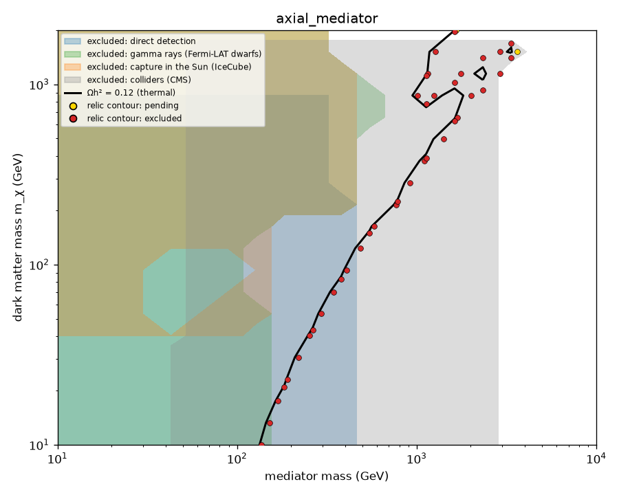
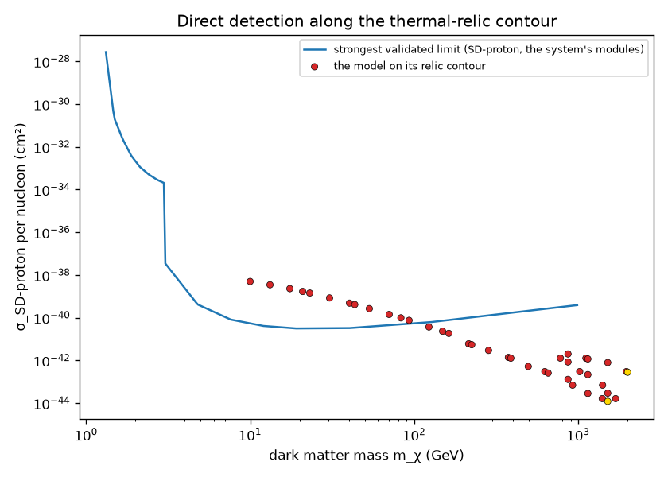

# Track 1: axial_mediator

## 1. The model

| field | role | spin | SU(3), SU(2), Y | other charges | Z2 | mass (GeV) |
|---|---|---|---|---|---|---|
| chi | dark_matter | Dirac 0.5 | (1, 1, 0) | — | odd | 100.0 |
| Zp | mediator | real 1 | (1, 1, 0) | — | even | 2000.0 |

**Valid**: Lorentz and gauge invariance, matching spins, hermiticity and dimension.

## 2. The verdict (thermal freeze-out)

**VIABLE, PENDING A CALCULATION**: parts of the thermal-relic contour survive every computed constraint, but a constraint that applies there is not yet computed (0 viable, 2 pending, 39 excluded of 41 points on the contour; excluding: colliders (CMS), direct detection, gamma rays (Fermi-LAT dwarfs)).

Class: axial_mediator (Spin1Class); fixed at g_chi = 1, g_q = 0.25, g_l = 0; scanned m_med over 10–1e+04 and m_chi over 10–2e+03 (20 × 20 points).

## 3. Parameter space

Points on the thermal-relic contour:

| m_med | m_chi | status | excluded by | still to compute |
|---|---|---|---|---|
| 137 | 10 | excluded | direct detection, gamma rays (Fermi-LAT dwarfs), colliders (CMS) | — |
| 151.3 | 13.22 | excluded | direct detection, gamma rays (Fermi-LAT dwarfs), colliders (CMS) | — |
| 169.2 | 17.47 | excluded | direct detection, colliders (CMS) | — |
| 183.3 | 20.91 | excluded | direct detection, colliders (CMS) | — |
| 191.6 | 23.08 | excluded | direct detection, colliders (CMS) | — |
| 219.8 | 30.51 | excluded | direct detection, colliders (CMS) | — |
| 253.4 | 40.32 | excluded | direct detection, colliders (CMS) | — |
| 263.7 | 43.44 | excluded | direct detection, colliders (CMS) | — |
| 295 | 53.29 | excluded | direct detection, colliders (CMS) | — |
| 345.6 | 70.43 | excluded | direct detection, colliders (CMS) | — |
| 379.3 | 82.99 | excluded | direct detection, colliders (CMS) | — |
| 405.9 | 93.08 | excluded | direct detection, colliders (CMS) | — |
| 485.6 | 123 | excluded | colliders (CMS) | — |
| 545.6 | 149 | excluded | colliders (CMS) | — |
| 577.8 | 162.6 | excluded | colliders (CMS) | — |
| 765.6 | 214.9 | excluded | colliders (CMS) | — |
| 784.8 | 224.2 | excluded | colliders (CMS) | — |
| 915.7 | 284 | excluded | colliders (CMS) | — |
| 1106 | 375.3 | excluded | colliders (CMS) | — |
| 1129 | 388.2 | excluded | colliders (CMS) | — |
| 1412 | 496 | excluded | colliders (CMS) | — |
| 1624 | 625.8 | excluded | colliders (CMS) | — |
| 1686 | 655.5 | excluded | colliders (CMS) | — |
| 1129 | 778.6 | excluded | colliders (CMS) | — |
| 1009 | 866.4 | excluded | colliders (CMS) | — |
| 1252 | 866.4 | excluded | colliders (CMS) | — |
| 2001 | 866.4 | excluded | colliders (CMS) | — |
| 2336 | 924.2 | excluded | colliders (CMS) | — |
| 1624 | 1021 | excluded | colliders (CMS) | direct detection (SD-proton): beyond the validated range of the system's modules |
| 1129 | 1114 | excluded | colliders (CMS) | direct detection (SD-proton): beyond the validated range of the system's modules |
| 1153 | 1145 | excluded | colliders (CMS) | direct detection (SD-proton): beyond the validated range of the system's modules |
| 1760 | 1145 | excluded | colliders (CMS) | direct detection (SD-proton): beyond the validated range of the system's modules |
| 2922 | 1145 | excluded | colliders (CMS) | direct detection (SD-proton): beyond the validated range of the system's modules |
| 3360 | 1401 | excluded | colliders (CMS) | direct detection (SD-proton): beyond the validated range of the system's modules |
| 2336 | 1408 | excluded | colliders (CMS) | direct detection (SD-proton): beyond the validated range of the system's modules |
| 1272 | 1513 | excluded | colliders (CMS) | direct detection (SD-proton): beyond the validated range of the system's modules |
| 2901 | 1513 | excluded | colliders (CMS) | direct detection (SD-proton): beyond the validated range of the system's modules |
| 3621 | 1513 | pending | — | direct detection (SD-proton): beyond the validated range of the system's modules |
| 3360 | 1691 | excluded | colliders (CMS) | direct detection (SD-proton): beyond the validated range of the system's modules |
| 1624 | 1966 | excluded | colliders (CMS) | direct detection (SD-proton): beyond the validated range of the system's modules |

## 4. What was computed, and what was not

- Relic density: thermal freeze-out, exact thermal average across resonances.
- Direct detection: the strongest validated limit of the system's modules at each mass.
- Gamma rays (Fermi-LAT dwarfs) and capture in the Sun (IceCube): curated records.
- Colliders: CMS's curated summary, for its benchmark couplings only.

## 5. Literature

Curated records (verified by the owner):

- Planck 2018, arXiv:1807.06209: Ωh² = 0.120 ± 0.001: the thermal target
- LHC Dark Matter Working Group, arXiv:1603.04156, 1703.05703: the spin-1 simplified models and their widths
- CMS summary of mediator searches, arXiv:2405.13778: collider exclusions of the Working Group's benchmarks
- Fermi-LAT, 15 dwarf galaxies, arXiv:1503.02641: ⟨σv⟩ limits by final state
- IceCube, the Sun, arXiv:1612.05949: limits on capture and annihilation in the Sun
- The direct-detection modules, docs/dm3_experiments.md: CRESST-III, CDMSlite, PICO-60, DEAP-3600, LZ, XENONnT, PandaX-4T, each within its validated range

Prior work (arXiv search: abs:"dark matter" AND abs:"axial-vector mediator" AND abs:"relic"; titles as arXiv returns them):

- arXiv:1703.05703 (2017): Recommendations of the LHC Dark Matter Working Group: Comparing LHC searches for heavy mediators of dark matter production in visible and invisible decay channels
- arXiv:1603.08525 (2016): Cosmological constraints on Dark Matter models for collider searches
- arXiv:1610.03063 (2016): Impact of Mass Generation for Simplified Dark Matter Models
- arXiv:1609.02188 (2016): Axial Vector $Z'$ and Anomaly Cancellation
