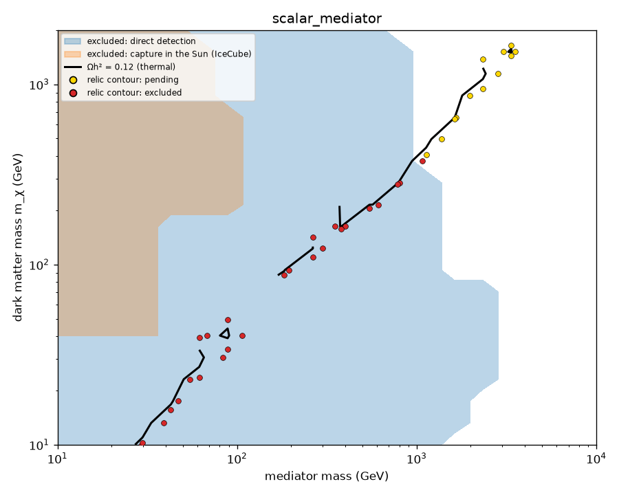
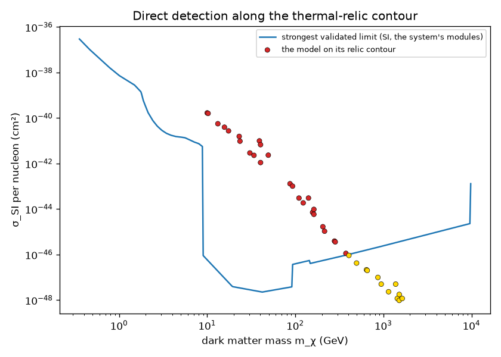

# Track 1: scalar_mediator

## 1. The model

| field | role | spin | SU(3), SU(2), Y | other charges | Z2 | mass (GeV) |
|---|---|---|---|---|---|---|
| chi | dark_matter | Dirac 0.5 | (1, 1, 0) | — | odd | 100.0 |
| phi | mediator | real 0 | (1, 1, 0) | — | even | 500.0 |

**Valid**: Lorentz and gauge invariance, matching spins, hermiticity and dimension.

## 2. The verdict (thermal freeze-out)

**VIABLE, PENDING A CALCULATION**: parts of the thermal-relic contour survive every computed constraint, but a constraint that applies there is not yet computed (0 viable, 12 pending, 26 excluded of 38 points on the contour; excluding: direct detection).

Class: scalar_mediator (ScalarClass); fixed at g_chi = 1, g_q = 1, g_l = 0; scanned m_med over 10–1e+04 and m_chi over 10–2e+03 (20 × 20 points).

## 3. Parameter space

Points on the thermal-relic contour:

| m_med | m_chi | status | excluded by | still to compute |
|---|---|---|---|---|
| 29.37 | 10 | excluded | direct detection | colliders: a recast of the LHC searches to this model |
| 29.76 | 10.24 | excluded | direct detection | colliders: a recast of the LHC searches to this model |
| 39.02 | 13.22 | excluded | direct detection | colliders: a recast of the LHC searches to this model |
| 42.81 | 15.7 | excluded | direct detection | colliders: a recast of the LHC searches to this model |
| 47.14 | 17.47 | excluded | direct detection | colliders: a recast of the LHC searches to this model |
| 54.53 | 23.08 | excluded | direct detection | colliders: a recast of the LHC searches to this model |
| 61.58 | 23.56 | excluded | direct detection | colliders: a recast of the LHC searches to this model |
| 83.32 | 30.51 | excluded | direct detection | colliders: a recast of the LHC searches to this model |
| 88.59 | 33.94 | excluded | direct detection | colliders: a recast of the LHC searches to this model |
| 61.58 | 39.15 | excluded | direct detection | colliders: a recast of the LHC searches to this model |
| 67.83 | 40.32 | excluded | direct detection | colliders: a recast of the LHC searches to this model |
| 106.6 | 40.32 | excluded | direct detection | colliders: a recast of the LHC searches to this model |
| 88.59 | 49.37 | excluded | direct detection | colliders: a recast of the LHC searches to this model |
| 183.3 | 87.13 | excluded | direct detection | colliders: a recast of the LHC searches to this model |
| 194.9 | 93.08 | excluded | direct detection | colliders: a recast of the LHC searches to this model |
| 263.7 | 110.1 | excluded | direct detection | colliders: a recast of the LHC searches to this model |
| 298.1 | 123 | excluded | direct detection | colliders: a recast of the LHC searches to this model |
| 263.7 | 141.2 | excluded | direct detection | colliders: a recast of the LHC searches to this model |
| 379.3 | 157.2 | excluded | direct detection | colliders: a recast of the LHC searches to this model |
| 351.5 | 162.6 | excluded | direct detection | colliders: a recast of the LHC searches to this model |
| 398.5 | 162.6 | excluded | direct detection | colliders: a recast of the LHC searches to this model |
| 545.6 | 205.5 | excluded | direct detection | colliders: a recast of the LHC searches to this model |
| 611.2 | 214.9 | excluded | direct detection | colliders: a recast of the LHC searches to this model |
| 784.8 | 278.7 | excluded | direct detection | colliders: a recast of the LHC searches to this model |
| 801.7 | 284 | excluded | direct detection | colliders: a recast of the LHC searches to this model |
| 1072 | 375.3 | excluded | direct detection | colliders: a recast of the LHC searches to this model |
| 1129 | 406.1 | pending | — | colliders: a recast of the LHC searches to this model |
| 1371 | 496 | pending | — | colliders: a recast of the LHC searches to this model |
| 1624 | 642.4 | pending | — | colliders: a recast of the LHC searches to this model |
| 1653 | 655.5 | pending | — | colliders: a recast of the LHC searches to this model |
| 1971 | 866.4 | pending | — | colliders: a recast of the LHC searches to this model |
| 2336 | 945 | pending | — | colliders: a recast of the LHC searches to this model |
| 2833 | 1145 | pending | — | colliders: a recast of the LHC searches to this model |
| 2336 | 1378 | pending | — | colliders: a recast of the LHC searches to this model |
| 3360 | 1438 | pending | — | colliders: a recast of the LHC searches to this model |
| 3032 | 1513 | pending | — | colliders: a recast of the LHC searches to this model |
| 3528 | 1513 | pending | — | colliders: a recast of the LHC searches to this model |
| 3360 | 1636 | pending | — | colliders: a recast of the LHC searches to this model |

## 4. What was computed, and what was not

- Relic density: thermal freeze-out, exact thermal average across resonances.
- Direct detection: the strongest validated limit of the system's modules at each mass.
- Gamma rays (Fermi-LAT dwarfs) and capture in the Sun (IceCube): curated records.
- Colliders: CMS's curated summary, for its benchmark couplings only.
- colliders: CMS's curated limits apply to its own benchmark couplings only; this model is not one of them, so collider constraints are not evaluated
- relic density: not computed where m_χ > (2/3)·m_S, since annihilation to two mediators (χχ̄ → SS) is not yet computed; the relic contour is drawn only below that line

## 5. Literature

Curated records (verified by the owner):

- Planck 2018, arXiv:1807.06209: Ωh² = 0.120 ± 0.001: the thermal target
- LHC Dark Matter Working Group, arXiv:1603.04156, 1703.05703: the spin-1 simplified models and their widths
- CMS summary of mediator searches, arXiv:2405.13778: collider exclusions of the Working Group's benchmarks
- Fermi-LAT, 15 dwarf galaxies, arXiv:1503.02641: ⟨σv⟩ limits by final state
- IceCube, the Sun, arXiv:1612.05949: limits on capture and annihilation in the Sun
- The direct-detection modules, docs/dm3_experiments.md: CRESST-III, CDMSlite, PICO-60, DEAP-3600, LZ, XENONnT, PandaX-4T, each within its validated range

Prior work (arXiv search: abs:"dark matter" AND abs:"scalar mediator" AND abs:"relic"; titles as arXiv returns them):

- arXiv:2412.18721 (2024): LHC-friendly freeze-in dark matter via Higgs portal
- arXiv:2112.06847 (2021): Singlet-Doublet Self-interacting Dark Matter and Radiative Neutrino Mass
- arXiv:2209.11408 (2022): A hidden self-interacting dark matter sector with first order cosmological phase transition and gravitational wave
- arXiv:2206.11041 (2022): W-boson mass anomaly and vacuum structure in vector dark matter model with a singlet scalar mediator
- arXiv:2508.16299 (2025): Renormalization Group Running of the Minimal Leptophilic Dark Matter Model toward a UV Completion
- arXiv:2412.19371 (2024): Velocity-dependent self-interacting dark matter and composite Higgs
- arXiv:2205.10149 (2022): A Global Analysis of Resonance-enhanced Light Scalar Dark Matter
- arXiv:2405.14610 (2024): Flavored Dark Matter: Freeze-out Scenarios and LHC Signatures
