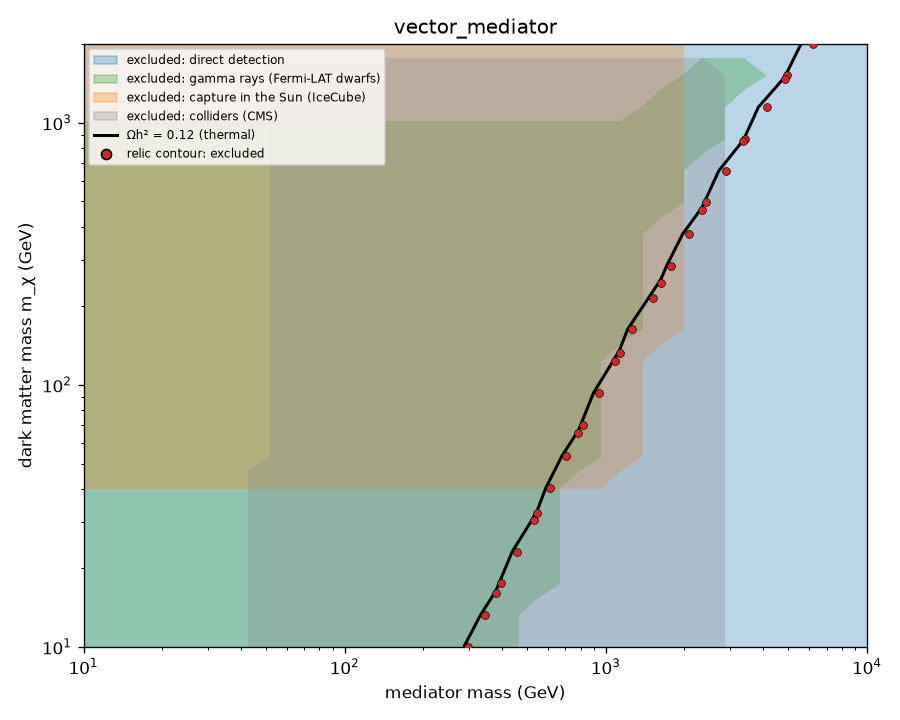
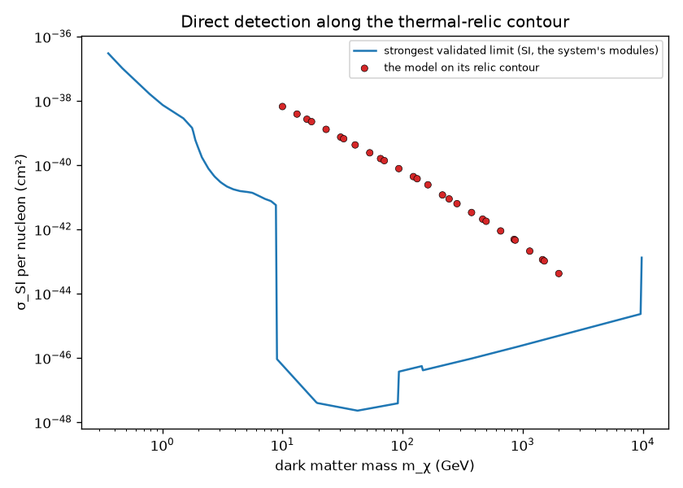

# Track 1: vector_mediator

## 1. The model

| field | role | spin | SU(3), SU(2), Y | other charges | Z2 | mass (GeV) |
|---|---|---|---|---|---|---|
| chi | dark_matter | Dirac 0.5 | (1, 1, 0) | — | odd | 100.0 |
| Zp | mediator | real 1 | (1, 1, 0) | — | even | 2000.0 |

**Valid**: Lorentz and gauge invariance, matching spins, hermiticity and dimension.

## 2. The verdict (thermal freeze-out)

**EXCLUDED**: the whole thermal-relic contour in the scanned region is excluded (0 viable, 0 pending, 28 excluded of 28 points on the contour; excluding: capture in the Sun (IceCube), colliders (CMS), direct detection, gamma rays (Fermi-LAT dwarfs)).

Class: vector_mediator (Spin1Class); fixed at g_chi = 1, g_q = 0.25, g_l = 0; scanned m_med over 10–1e+04 and m_chi over 10–2e+03 (20 × 20 points).

## 3. Parameter space

Points on the thermal-relic contour:

| m_med | m_chi | status | excluded by | still to compute |
|---|---|---|---|---|
| 297.2 | 10 | excluded | direct detection, gamma rays (Fermi-LAT dwarfs), colliders (CMS) | — |
| 343.7 | 13.22 | excluded | direct detection, gamma rays (Fermi-LAT dwarfs), colliders (CMS) | — |
| 379.3 | 15.99 | excluded | direct detection, gamma rays (Fermi-LAT dwarfs), colliders (CMS) | — |
| 397.1 | 17.47 | excluded | direct detection, gamma rays (Fermi-LAT dwarfs), colliders (CMS) | — |
| 458.7 | 23.08 | excluded | direct detection, gamma rays (Fermi-LAT dwarfs), colliders (CMS) | — |
| 529.5 | 30.51 | excluded | direct detection, gamma rays (Fermi-LAT dwarfs), colliders (CMS) | — |
| 545.6 | 32.33 | excluded | direct detection, gamma rays (Fermi-LAT dwarfs), colliders (CMS) | — |
| 611.4 | 40.32 | excluded | direct detection, gamma rays (Fermi-LAT dwarfs), capture in the Sun (IceCube), colliders (CMS) | — |
| 705.8 | 53.29 | excluded | direct detection, gamma rays (Fermi-LAT dwarfs), capture in the Sun (IceCube), colliders (CMS) | — |
| 784.8 | 65.57 | excluded | direct detection, gamma rays (Fermi-LAT dwarfs), capture in the Sun (IceCube), colliders (CMS) | — |
| 814.2 | 70.43 | excluded | direct detection, gamma rays (Fermi-LAT dwarfs), capture in the Sun (IceCube), colliders (CMS) | — |
| 941.1 | 93.08 | excluded | direct detection, gamma rays (Fermi-LAT dwarfs), capture in the Sun (IceCube), colliders (CMS) | — |
| 1087 | 123 | excluded | direct detection, capture in the Sun (IceCube), colliders (CMS) | — |
| 1129 | 132.2 | excluded | direct detection, capture in the Sun (IceCube), colliders (CMS) | — |
| 1260 | 162.6 | excluded | direct detection, capture in the Sun (IceCube), colliders (CMS) | — |
| 1513 | 214.9 | excluded | direct detection, capture in the Sun (IceCube), colliders (CMS) | — |
| 1624 | 244.1 | excluded | direct detection, capture in the Sun (IceCube), colliders (CMS) | — |
| 1769 | 284 | excluded | direct detection, capture in the Sun (IceCube), colliders (CMS) | — |
| 2074 | 375.3 | excluded | direct detection, colliders (CMS) | — |
| 2336 | 464.4 | excluded | direct detection, colliders (CMS) | — |
| 2426 | 496 | excluded | direct detection, colliders (CMS) | — |
| 2886 | 655.5 | excluded | direct detection | — |
| 3360 | 848.5 | excluded | direct detection | — |
| 3403 | 866.4 | excluded | direct detection | — |
| 4144 | 1145 | excluded | direct detection | — |
| 4833 | 1465 | excluded | direct detection | — |
| 4941 | 1513 | excluded | direct detection | — |
| 6196 | 2000 | excluded | direct detection | — |

## 4. What was computed, and what was not

- Relic density: thermal freeze-out, exact thermal average across resonances.
- Direct detection: the strongest validated limit of the system's modules at each mass.
- Gamma rays (Fermi-LAT dwarfs) and capture in the Sun (IceCube): curated records.
- Colliders: CMS's curated summary, for its benchmark couplings only.

## 5. Literature

Curated records (verified by the owner):

- Planck 2018, arXiv:1807.06209: Ωh² = 0.120 ± 0.001: the thermal target
- LHC Dark Matter Working Group, arXiv:1603.04156, 1703.05703: the spin-1 simplified models and their widths
- CMS summary of mediator searches, arXiv:2405.13778: collider exclusions of the Working Group's benchmarks
- Fermi-LAT, 15 dwarf galaxies, arXiv:1503.02641: ⟨σv⟩ limits by final state
- IceCube, the Sun, arXiv:1612.05949: limits on capture and annihilation in the Sun
- The direct-detection modules, docs/dm3_experiments.md: CRESST-III, CDMSlite, PICO-60, DEAP-3600, LZ, XENONnT, PandaX-4T, each within its validated range

Prior work (arXiv search: abs:"dark matter" AND abs:"vector mediator" AND abs:"relic"; titles as arXiv returns them):

- arXiv:2107.10913 (2021): Vector Portal Pseudo-Goldstone Dark Matter
- arXiv:1509.07867 (2015): Constraints on Majorana Dark Matter from the LHC and IceCube
- arXiv:1705.05149 (2017): Spin-3/2 dark matter in a simple $t$-channel model
- arXiv:1804.10385 (2018): Self-interacting dark matter with a stable vector mediator
- arXiv:2603.03444 (2026): New Thermal-Relic Targets for sub-GeV Dark Matter Direct Detection
- arXiv:2308.03680 (2023): Investigation of spin-dependent dark matter in mono-photon production at high-energy colliders
- arXiv:1903.00006 (2019): Neutrino Portals to Dark Matter
- arXiv:1608.08958 (2016): Minimal Spin-3/2 Dark Matter in a simple $s$-channel model
