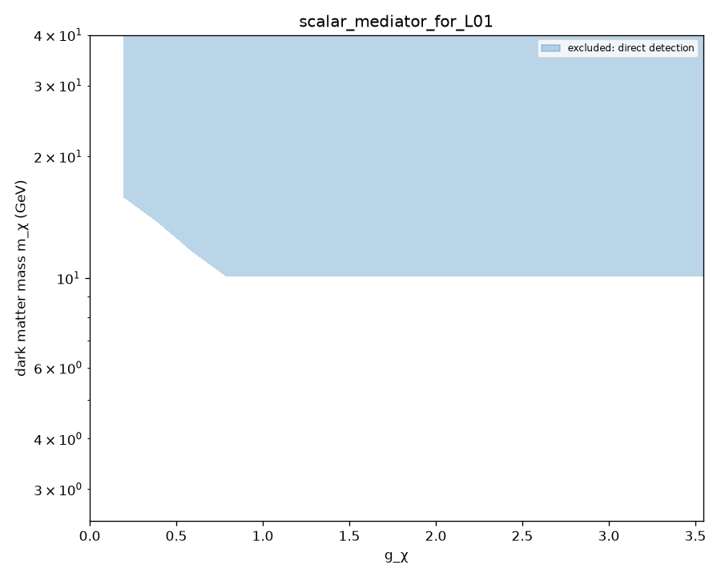

# Single idea: scalar_mediator_for_L01 as the explanation of CDMS II Si (2013)

<!-- adroit-chronology -->
Report generated (UTC): 2026-10-11T06:07:57.777561+00:00
Calculation started (UTC): 2026-10-11T06:06:53.142690+00:00
Calculation completed (UTC): 2026-10-11T06:07:57.698696+00:00
Calculation input identity: `6d40fff9e6df968beca23485e635ff71079928fca5ac083a6b60d1b65dd00821`
Conclusions apply to the recorded inputs and calculation date; later data or revisions require a new analysis.
<!-- /adroit-chronology -->

**NO FIT**: the model fits the events no better than the background alone (local Z < 1 at every mass).

## 1. The fit

Best fit: scalar_mediator_for_L01@9.999999999999998; unconstrained NR-reference global significance over the 7 masses 2.69σ (5,000 background-only toys, the background's rate profiled (expected 0.41 events, −62% +84%; background-only fit θ̂₀ = 1.85); p = 0.0036 (95% interval 0.00213–0.00568, 18 of 5,000 toys), Z 2.53–2.86; promoted from a library-wide search whose global significance is 2.77σ: this study's own trials factor covers only its masses, so the parent's applies). μ scales the NR amplitude; μ = 1 is its stated couplings. The physical band varies g_chi within its declared range or original-sign perturbative branch, keeping masses and other couplings fixed.

| m_χ (GeV) | NR local Z / physical √q0 | μ̂ (68%, NR reference) | physical g_chi (nominal likelihood region); fixed m_med | Ωh² (relative thermal residual) | status | excluded by |
|---|---|---|---|---|---|---|
| 2.5 | 0.00 | 0 (0–0) | 0 (0–0); 1000 GeV | 2.38e+06 | pending | — |
| 3.97 | 0.00 | 0 (0–0) | 0 (0–0); 1000 GeV | 3.55e+06 | pending | — |
| 6.3 | 2.64 / 0.00 | 1.05e+03 (684–1.45e+03) | 3.54 (0–3.54); 1000 GeV | 4.31e+04 | pending | — |
| 10 | 2.99 / 0.00 | 268 (189–354) | 3.54 (0–3.54); 1000 GeV | 1.47e+04 | excluded | direct detection |
| 15.9 | 2.55 / 0.00 | 135 (92.7–179) | 3.54 (0–3.54); 1000 GeV | 6.36e+03 | excluded | direct detection |
| 25.2 | 1.93 / 0.00 | 91.9 (57.7–125) | 3.54 (0–3.54); 1000 GeV | 2.92e+03 | excluded | direct detection |
| 40 | 1.27 / 0.00 | 71.3 (30.9–103) | 3.54 (0–3.54); 1000 GeV | 1.37e+03 | excluded | direct detection |

The reported global significance and null-amplitude comparison remain the unconstrained NR reference calculations. Bounded physical q0 is descriptive; discovery significance for the signal-only band has not been recalibrated. Native pair calibration, when requested, is reported separately for its own physical domain.

Best resolved physical-fit mass: 2.5 GeV.

- 6.29961 GeV bounded g_chi: [0, 3.54491], resolved=True, identifiable=True, boundary=True, 189/512 spectrum evaluations; nominal likelihood regions: [0, 3.54491] (truncated at physical bound). 
- 10 GeV bounded g_chi: [0, 3.54491], resolved=True, identifiable=True, boundary=True, 200/512 spectrum evaluations; nominal likelihood regions: [0, 3.54491] (truncated at physical bound). 
- 15.874 GeV bounded g_chi: [0, 3.54491], resolved=True, identifiable=True, boundary=True, 189/512 spectrum evaluations; nominal likelihood regions: [0, 3.54491] (truncated at physical bound). 
- 25.1984 GeV bounded g_chi: [0, 3.54491], resolved=True, identifiable=True, boundary=True, 189/512 spectrum evaluations; nominal likelihood regions: [0, 3.54491] (truncated at physical bound). 
- 40 GeV bounded g_chi: [0, 3.54491], resolved=True, identifiable=True, boundary=True, 201/512 spectrum evaluations; nominal likelihood regions: [0, 3.54491] (truncated at physical bound). 
Physical best-fit constraint compatibility: undetermined; thermal viability: no_fit.

- 6.29961 GeV: fitted amplitude lies outside the perturbative g_chi branch
- 10 GeV: fitted amplitude lies outside the perturbative g_chi branch
- 15.874 GeV: fitted amplitude lies outside the perturbative g_chi branch
- 25.1984 GeV: fitted amplitude lies outside the perturbative g_chi branch
- 40 GeV: fitted amplitude lies outside the perturbative g_chi branch

## 2. The null experiments (unconstrained NR reference)

At the best mass the signal alone wants μ̂ = 268 (Z = 2.99); with the null experiments μ̂ = 268 (Z = 2.99). Their tension: χ²_PG = 0.00, p = 1.

## 3. Track 1 around the band

The band (magenta) is drawn on the plane; the rest is Track 1's report on the same window.

### The verdict (thermal freeze-out)

**NO RESOLVED THERMAL ROOT (samples overabundant)**: all 100 computed grid samples are above the target; no thermal root resolved at this scan resolution (features between samples are not ruled out).

Class: scalar_mediator_for_L01 (ScalarClass); fixed at m_med = 1000, g_q = 1, g_l = 0; scanned g_chi over 0–3.54 and m_chi over 2.5–40 (10 × 10 points).

### 3. Parameter space

### 4. What was computed, and what was not

- Relic density: thermal freeze-out, exact thermal average across resonances.
- Direct detection: a new 95% limit from the module procedure, restricted to its native-curve validated mass range. Native 90% validation is retained separately.
- Gamma rays (Fermi-LAT dwarfs): supported pure prompt channels at 95%. IceCube: native 90% only; its 95% comparison remains pending.
- Colliders: CMS's curated summary, for its benchmark couplings only.
- Invisible widths of the Higgs and Z bosons (portal models): against ATLAS's and LEP's records, used once a person has verified them.
- colliders: CMS's curated limits apply to its own benchmark couplings only; this model is not one of them, so collider constraints are not evaluated

### 5. Literature

Curated records and sources:
Planck density record: awaits a person's verification. Other record status is shown in Records; unverified constraints stay pending unless explicitly requested.

- Planck 2018, arXiv:1807.06209: Ωh² = 0.1200 ± 0.0012: Table 2, TT,TE,EE+lowE+lensing
- LHC Dark Matter Working Group, arXiv:1603.04156, 1703.05703: the spin-1 simplified models and their widths
- CMS summary of mediator searches, arXiv:2405.13778: collider exclusions of the Working Group's benchmarks
- Fermi-LAT, 15 dwarf galaxies, arXiv:1503.02641: ⟨σv⟩ limits by final state
- IceCube, the Sun, arXiv:1612.05949: limits on capture and annihilation in the Sun
- The direct-detection modules, docs/dm3_experiments.md: CRESST-III, CDMSlite, PICO-60, DEAP-3600, LZ, XENONnT, PandaX-4T, each within its validated range

Prior work (arXiv search: abs:"dark matter" AND abs:"scalar mediator" AND abs:"relic"; titles as arXiv returns them):

- arXiv:2412.18721 (2024): LHC-friendly freeze-in dark matter via Higgs portal
- arXiv:2112.06847 (2021): Singlet-Doublet Self-interacting Dark Matter and Radiative Neutrino Mass
- arXiv:2209.11408 (2022): A hidden self-interacting dark matter sector with first order cosmological phase transition and gravitational wave
- arXiv:2206.11041 (2022): W-boson mass anomaly and vacuum structure in vector dark matter model with a singlet scalar mediator
- arXiv:2508.16299 (2025): Renormalization Group Running of the Minimal Leptophilic Dark Matter Model toward a UV Completion
- arXiv:2412.19371 (2024): Velocity-dependent self-interacting dark matter and composite Higgs
- arXiv:2205.10149 (2022): A Global Analysis of Resonance-enhanced Light Scalar Dark Matter
- arXiv:2405.14610 (2024): Flavored Dark Matter: Freeze-out Scenarios and LHC Signatures

