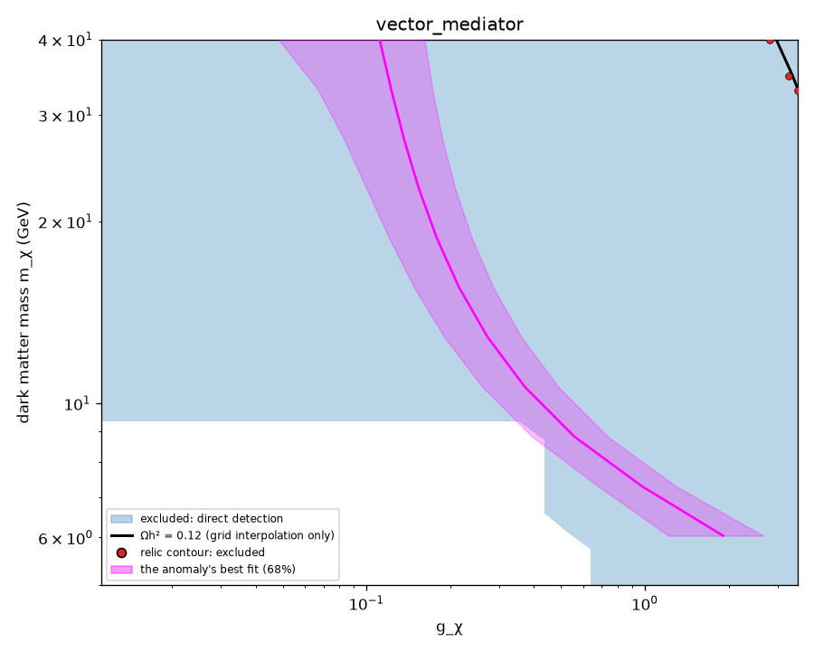
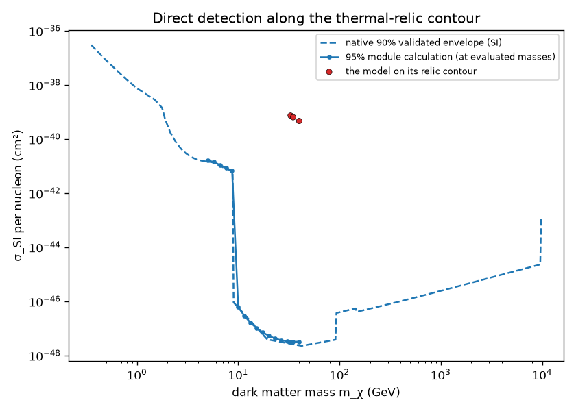

# Single idea: vector_mediator as the explanation of CDMS II Si (2013)

<!-- adroit-chronology -->
Report generated (UTC): 2026-10-11T06:06:42.408257+00:00
Calculation started (UTC): 2026-10-11T06:03:51.704277+00:00
Calculation completed (UTC): 2026-10-11T06:06:42.020350+00:00
Calculation input identity: `4f45f1464fd416e5e5fa3d146ca9cb4982c49901cbb8145d4d9056658320785b`
Conclusions apply to the recorded inputs and calculation date; later data or revisions require a new analysis.
<!-- /adroit-chronology -->

**NO RESOLVED THERMAL EXPLANATION**: no thermal intersection fitting the anomaly was resolved over the searched masses; features between samples are not ruled out.

## 1. The fit

Best fit: vector_mediator@8.815912549960212; unconstrained NR-reference global significance over the 12 masses 2.85σ (20,000 background-only toys, the background's rate profiled (expected 0.41 events, −62% +84%; background-only fit θ̂₀ = 1.85); p = 0.0022 (95% interval 0.0016–0.00295, 44 of 20,000 toys), Z 2.75–2.95). μ scales the NR amplitude; μ = 1 is its stated couplings. The physical band varies g_chi within its declared range or original-sign perturbative branch, keeping masses and other couplings fixed.

| m_χ (GeV) | NR local Z / physical √q0 | μ̂ (68%, NR reference) | physical g_chi (nominal likelihood region); fixed m_med | Ωh² (relative thermal residual) | status | excluded by |
|---|---|---|---|---|---|---|
| 5 | 1.61 / 0.00 | 6.3 (2.97–9.88) | 3.54 (1.97–3.54); 1000 GeV | 5.07 | excluded | direct detection |
| 6.04 | 2.51 | 1.91 (1.22–2.67) | 1.91 (1.22–2.67); 1000 GeV | 9.52 | excluded | direct detection |
| 7.3 | 2.99 | 0.975 (0.679–1.29) | 0.975 (0.679–1.29); 1000 GeV | 22.5 | excluded | direct detection |
| 8.82 | 3.04 | 0.558 (0.393–0.735) | 0.558 (0.393–0.735); 1000 GeV | 43.9 | excluded | direct detection |
| 10.7 | 2.95 | 0.371 (0.261–0.488) | 0.371 (0.261–0.488); 1000 GeV | 65.3 | excluded | direct detection |
| 12.9 | 2.79 | 0.273 (0.191–0.36) | 0.273 (0.191–0.36); 1000 GeV | 80.7 | excluded | direct detection |
| 15.5 | 2.58 | 0.215 (0.148–0.286) | 0.215 (0.148–0.286); 1000 GeV | 87.6 | excluded | direct detection |
| 18.8 | 2.34 | 0.179 (0.12–0.239) | 0.179 (0.12–0.239); 1000 GeV | 86.6 | excluded | direct detection |
| 22.7 | 2.08 | 0.154 (0.0999–0.208) | 0.154 (0.0999–0.208); 1000 GeV | 80.1 | excluded | direct detection |
| 27.4 | 1.81 | 0.136 (0.0829–0.187) | 0.136 (0.0829–0.187); 1000 GeV | 70.7 | excluded | direct detection |
| 33.1 | 1.54 | 0.123 (0.0667–0.172) | 0.123 (0.0667–0.172); 1000 GeV | 60.4 | excluded | direct detection |
| 40 | 1.27 | 0.111 (0.0483–0.162) | 0.111 (0.0483–0.162); 1000 GeV | 50.6 | excluded | direct detection |

The reported global significance and null-amplitude comparison remain the unconstrained NR reference calculations. Bounded physical q0 is descriptive; discovery significance for the signal-only band has not been recalibrated. Native pair calibration, when requested, is reported separately for its own physical domain.

Best resolved physical-fit mass: 8.815912549960212 GeV.

- 5 GeV bounded g_chi: [0, 3.54491], resolved=True, identifiable=True, boundary=True, 195/512 spectrum evaluations; nominal likelihood regions: [1.96905, 3.54491] (truncated at physical bound). 
Physical best-fit constraint compatibility: excluded; thermal viability: no_thermal.

- 5 GeV: fitted amplitude lies outside the perturbative g_chi branch

## 2. The null experiments (unconstrained NR reference)

At the best mass the signal alone wants μ̂ = 0.558 (Z = 3.04); with the null experiments μ̂ = 0.182 (Z = 1.05). Their tension: χ²_PG = 8.15, p = 0.0043.

- CRESST-III 2019: μ_up = 0.325
- CDMSlite Run 2: μ_up = 0.358
- Null coverage pending, PICO-60 C3F8 (2019): unvalidated: the module's spin-independent procedure is not validated at this mass

## 3. Track 1 around the band

The band (magenta) is drawn on the plane; the rest is Track 1's report on the same window.

### The verdict (thermal freeze-out)

**EXCLUDED**: all resolved thermal samples at this scan resolution are excluded; unsampled features are not ruled out (0 viable, 0 pending, 3 excluded).

Class: vector_mediator (Spin1Class); fixed at m_med = 1000, g_q = 0.25, g_l = 0; scanned g_chi over 0.0111–3.54 and m_chi over 5–40 (16 × 16 points).

### 3. Parameter space

Points on the thermal-relic contour:

| g_chi | m_chi | kind; Ωh²; relative residual | status | excluded by | still to compute |
|---|---|---|---|---|---|
| 3.545 | 32.9 | contour; 0.12; 4.03e-07 | excluded | direct detection | capture in the Sun (IceCube): the annihilation is not one pure channel of the published curves (bb̄, W⁺W⁻, τ⁺τ⁻); Fermi-LAT dwarfs: mixed/cascade 2024 dwarf spectral recast awaits a person's verification; CMB (Planck): its record (planck-2018-pann) awaits a person's verification; LHC searches (SModelS): its record (smodels-3.2.1) awaits a person's verification; antiprotons (AMS-02): its record (calore-2202.03076-pbar) awaits a person's verification; LHC dijet resonances (CMS, ATLAS): Γ/m = 0.36 is broader than ATLAS's 15% Gaussian |
| 3.3 | 34.82 | contour; 0.119999; 7.35e-06 | excluded | direct detection | capture in the Sun (IceCube): the annihilation is not one pure channel of the published curves (bb̄, W⁺W⁻, τ⁺τ⁻); Fermi-LAT dwarfs: mixed/cascade 2024 dwarf spectral recast awaits a person's verification; CMB (Planck): its record (planck-2018-pann) awaits a person's verification; LHC searches (SModelS): its record (smodels-3.2.1) awaits a person's verification; antiprotons (AMS-02): its record (calore-2202.03076-pbar) awaits a person's verification; LHC dijet resonances (CMS, ATLAS): a broad Z′ (Γ/m = 0.32) at 1000 GeV: CMS's limit is for narrow resonances and ATLAS's Gaussian limits start at 1.5 TeV |
| 2.804 | 40 | contour; 0.120001; 7e-06 | excluded | direct detection | capture in the Sun (IceCube): the annihilation is not one pure channel of the published curves (bb̄, W⁺W⁻, τ⁺τ⁻); Fermi-LAT dwarfs: mixed/cascade 2024 dwarf spectral recast awaits a person's verification; CMB (Planck): its record (planck-2018-pann) awaits a person's verification; LHC searches (SModelS): its record (smodels-3.2.1) awaits a person's verification; antiprotons (AMS-02): its record (calore-2202.03076-pbar) awaits a person's verification; LHC dijet resonances (CMS, ATLAS): a broad Z′ (Γ/m = 0.24) at 1000 GeV: CMS's limit is for narrow resonances and ATLAS's Gaussian limits start at 1.5 TeV |

### 4. What was computed, and what was not

- Relic density: thermal freeze-out, exact thermal average across resonances.
- Direct detection: a new 95% limit from the module procedure, restricted to its native-curve validated mass range. Native 90% validation is retained separately.
- Gamma rays (Fermi-LAT dwarfs): supported pure prompt channels at 95%. IceCube: native 90% only; its 95% comparison remains pending.
- Colliders: CMS's curated summary, for its benchmark couplings only.
- Invisible widths of the Higgs and Z bosons (portal models): against ATLAS's and LEP's records, used once a person has verified them.
- colliders: CMS's curated limits apply to its own benchmark couplings only; this model is not one of them, so collider constraints are not evaluated

### 5. Literature

Curated records and sources:
Planck density record: awaits a person's verification. Other record status is shown in Records; unverified constraints stay pending unless explicitly requested.

- Planck 2018, arXiv:1807.06209: Ωh² = 0.1200 ± 0.0012: Table 2, TT,TE,EE+lowE+lensing
- LHC Dark Matter Working Group, arXiv:1603.04156, 1703.05703: the spin-1 simplified models and their widths
- CMS summary of mediator searches, arXiv:2405.13778: collider exclusions of the Working Group's benchmarks
- Fermi-LAT, 15 dwarf galaxies, arXiv:1503.02641: ⟨σv⟩ limits by final state
- IceCube, the Sun, arXiv:1612.05949: limits on capture and annihilation in the Sun
- The direct-detection modules, docs/dm3_experiments.md: CRESST-III, CDMSlite, PICO-60, DEAP-3600, LZ, XENONnT, PandaX-4T, each within its validated range

Prior work (arXiv search: abs:"dark matter" AND abs:"vector mediator" AND abs:"relic"; titles as arXiv returns them):

- arXiv:2107.10913 (2021): Vector Portal Pseudo-Goldstone Dark Matter
- arXiv:1509.07867 (2015): Constraints on Majorana Dark Matter from the LHC and IceCube
- arXiv:1705.05149 (2017): Spin-3/2 dark matter in a simple $t$-channel model
- arXiv:1804.10385 (2018): Self-interacting dark matter with a stable vector mediator
- arXiv:2603.03444 (2026): New Thermal-Relic Targets for sub-GeV Dark Matter Direct Detection
- arXiv:2308.03680 (2023): Investigation of spin-dependent dark matter in mono-photon production at high-energy colliders
- arXiv:1903.00006 (2019): Neutrino Portals to Dark Matter
- arXiv:1608.08958 (2016): Minimal Spin-3/2 Dark Matter in a simple $s$-channel model

